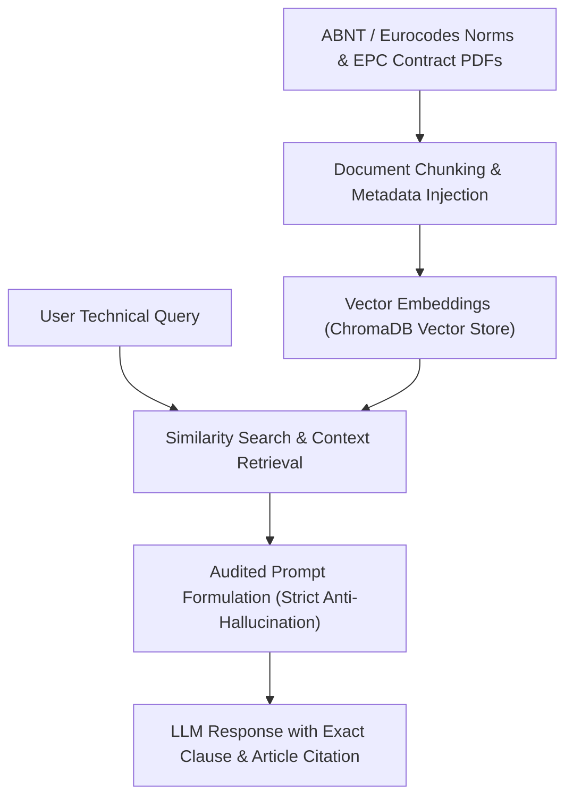

# Contract & Technical Specification Compliance Assistant
### Enterprise RAG Architecture under PMI-CPMAI™ Governance

[](https://www.langchain.com/)
[](https://www.trychroma.com/)
[](#)
[](https://streamlit.io/)

An executive GenAI compliance assistant designed to ingest hundreds of pages of engineering specifications (ABNT NBR, Eurocodes, ASTM) and complex EPC (Engineering, Procurement, Construction) contractual clauses, answering technical queries with strict citation auditing.



## Governance & PMI-CPMAI™ Compliance
Built in direct accordance with the **PMI-CPMAI™ (Cognitive Project Management in AI)** framework:
- **Domain I (Responsible AI):** Deterministic audit trail referencing exact norm standard, article number, and page citation.
- **Domain II (Business Viability):** Reduces technical contract verification time from 40 hours to under 30 minutes.
- **Domain III (Data Quality):** Strict chunking strategy preventing semantic drift across technical tolerances and safety factors.

## Quickstart
```bash
git clone https://github.com/master-dev0000/contract-spec-rag-assistant.git
cd contract-spec-rag-assistant
pip install -r requirements.txt
streamlit run app/app.py
```

## License
MIT License. Developed by André Belarmino Alves.
